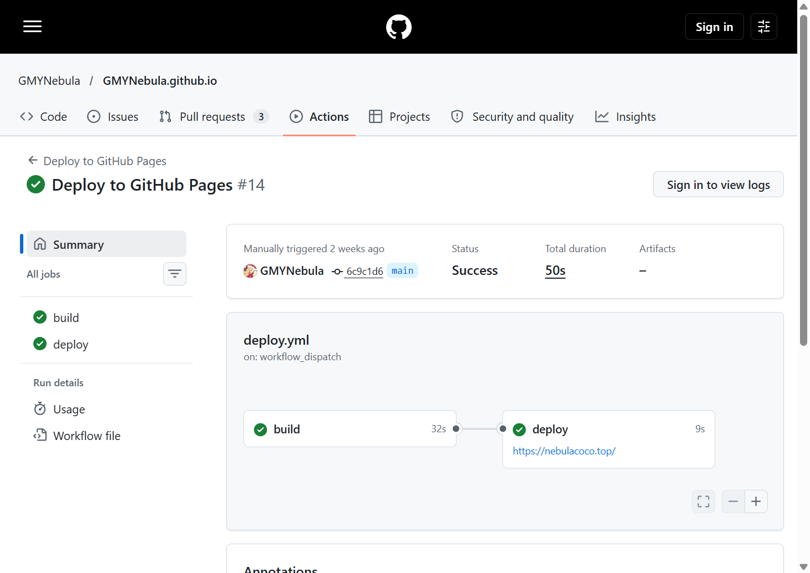

# 前言

最近，我开始逐渐接触 Vibe Coding，也切身感受到了 AI 辅助编程带来的效率提升。于是，一个搁置已久的念头重新浮现：是时候重新拾起博客了。

第一次搭建个人博客时，我选择了 Hexo。它上手简单、生态成熟，丰富的主题和插件让我即使缺乏前端开发经验，也能快速搭建一个功能完善的博客。不过，这一次，我希望尝试更多个性化的设计与功能，而不只是依赖现成的主题。恰好，Vibe Coding 为这种尝试提供了新的可能。借助 AI，我可以更高效地查阅资料、编写代码和调整样式，降低定制网站的时间成本。

带着对个性化开发的需求，我开始了解现代网站开发方案，并逐渐注意到了 [Astro](https://docs.astro.build/zh-cn/concepts/why-astro/)。它面向内容网站的设计理念、灵活的组件化开发方式，以及对静态页面生成的支持，都与我对新博客的设想十分契合。最终，我决定使用 Astro 构建博客，并选择 [GitHub Pages](https://docs.github.com/zh/pages/getting-started-with-github-pages/) 作为托管平台。接下来，我将记录从项目初始化、页面定制到自动部署的搭建过程，并分享实践中遇到的问题与解决方法。

# Astro 安装与项目初始化

Astro 是面向内容型网站的 Web 框架，博客、文档和作品集都是它常见的使用场景。对这个项目而言，文章主要以 Markdown 保存，页面又需要自己调整样式和交互；Astro 可以把内容、组件和构建流程放在同一个项目里管理，也能在构建时生成静态文件。这是我选择它的主要原因。

## 安装流程

### 1. 环境准备

本站的 `package.json` 要求 Node.js 版本不低于 `22.12.0`。安装完成后，在终端确认两者都能打出版本号：

```bash title="检查 Node.js 与 npm"
node -v
npm -v
```

```text title="输出"
v24.11.1
11.6.2
```

版本号能正常显示，且 Node.js 不低于 `22.12.0`，就可以继续。

### 2. 创建 Astro 项目

这个博客从 Astro 的 Blog 模板开始。在目标目录运行下面的命令；向导中安装依赖和初始化 Git 都选择确认后，会看到初始化完成的结果：

```bash title="创建项目（Blog 模板）"
npm create astro@latest NicoCatBlog -- --template blog
```

```text title="输出"
astro   Launch sequence initiated.

      ◼  dir Using NicoCatBlog as project directory
      ◼  tmpl Using blog as project template

      ✔  Project initialized!
         ■ Template copied
         ■ Dependencies installed
         ■ Git initialized

  next   Liftoff confirmed. Explore your project!

         Enter your project directory using cd ./NicoCatBlog
         Run npm run dev to start the dev server. q + ENTER to stop.
```

模板提供了基本的文章页和首页，适合作为起点。之后的页面、内容和样式都是在这个基础上逐步调整的，而不是从零搭建一套站点框架。

### 3. 启动本地开发服务器

进入项目目录后运行：

```bash title="启动本地开发服务器"
npm run dev
```

```text title="输出"
> nicocatblog@0.0.1 dev
> astro dev

[content] Synced content
astro  v7.2.9 ready in 3269 ms
┃ Local    http://localhost:4321/
┃ Network  use --host to expose
watching for file changes...
```

看到 `ready` 和 `Local` 地址后，开发服务器就已经可用。保存文件时，它会更新页面，适合边写文章、边调整页面并立即查看结果。

### 4. 了解项目目录结构

开始修改前，先区分内容、页面和可复用组件所在的位置，会减少后续调整时误改文件的情况：

| 目录或文件 | 在本站中的作用 |
| --- | --- |
| `src/content/blog/` | 博客文章，`.md` 或 `.mdx` 文件各对应一篇文章 |
| `src/pages/` | 页面和路由，例如文章详情页、归档页 |
| `src/components/`、`src/layouts/` | 复用的页面部件和文章布局 |
| `src/assets/` | 需要由 Astro 处理的封面和正文图片 |
| `astro.config.mjs` | 站点域名、Markdown 扩展与构建相关配置 |

# GitHub Pages 部署

[GitHub Pages](https://docs.github.com/zh/pages/getting-started-with-github-pages/) 可以托管仓库构建出的静态网站。Astro 的构建结果正好是静态文件，所以不需要单独准备服务器或运行 Node 服务。代码已经使用 GitHub 管理时，把构建和发布接到 [GitHub Actions](https://docs.github.com/zh/pages/getting-started-with-github-pages/using-custom-workflows-with-github-pages)，也能让每一次上线都有对应的提交和构建记录。

## 部署流程

### 1. 创建 GitHub 仓库

Astro 项目需要先推送到 GitHub 仓库。这个博客沿用了原来的个人站点仓库：旧站使用 Hexo，新站改由 `main` 分支上的 Astro 项目发布。无论是新建仓库还是迁移旧站，发布前都应确认默认分支和 GitHub Pages 的发布来源一致。

### 2. 配置 Astro 项目

`astro.config.mjs` 中的 `site` 需要写成实际站点地址；本站配置为 `https://nebulacoco.top`。RSS、sitemap 和分享链接等需要完整网址的功能都会使用这项配置。

构建命令也写在 `package.json` 中：

```json title="package.json"
"build": "astro build && npx --yes pagefind --site dist"
```

它会先生成 `dist/`，再由 Pagefind 为构建结果生成站内搜索索引。上线前可先在本地运行下面的命令；需要查看最终静态产物时，再运行 `npm run preview`。

```bash title="本地构建"
npm run build
```

```text title="输出（节选）"
> nicocatblog@0.0.1 build
> astro build && npx --yes pagefind --site dist

[content] Synced content
[build] output: "static"
[build] 30 page(s) built in 4.28s
[build] Complete!

Running Pagefind v1.5.2 (Extended)
Indexed 3 pages
Finished in 0.545 seconds
```

### 3. 配置 GitHub Actions 自动部署

仓库中的 `.github/workflows/deploy.yml` 负责部署。当前工作流会在推送到 `main` 或 `master` 时运行；但 `github-pages` 环境只允许 `main` 部署，因此日常发布应推送到 `main`。工作流会安装依赖、执行构建、上传 `dist/`，最后部署到 GitHub Pages。下面是当前使用的完整配置：

```yaml title=".github/workflows/deploy.yml"
name: Deploy to GitHub Pages

on:
  push:
    branches: [main, master]
  workflow_dispatch:

permissions:
  contents: read
  pages: write
  id-token: write

concurrency:
  group: pages
  cancel-in-progress: true

jobs:
  build:
    runs-on: ubuntu-latest
    steps:
      - uses: actions/checkout@v5
      - uses: actions/setup-node@v5
        with:
          node-version: 22
          cache: npm
      - run: npm ci --legacy-peer-deps
      - run: npm run build
      - uses: actions/upload-pages-artifact@v3
        with:
          path: dist

  deploy:
    needs: build
    runs-on: ubuntu-latest
    environment:
      name: github-pages
      url: ${{ steps.deployment.outputs.page_url }}
    steps:
      - uses: actions/deploy-pages@v4
        id: deployment
```

几个与本站直接相关的配置项：

- `push.branches`：推送到 `main` 或 `master` 都会触发工作流；不过部署环境只允许 `main`，所以日常发布仍使用 `main`。
- `workflow_dispatch`：让 Actions 页面提供手动运行按钮，部署失败或需要重新发布时可以不用再次提交代码。
- `permissions`：`contents: read` 允许读取仓库，`pages: write` 和 `id-token: write` 是 Pages 部署所需权限。
- `concurrency`：同一时间只保留一个 Pages 部署；新的部署会取消仍在进行的旧部署，避免较早的构建结果覆盖较新的版本。
- `setup-node`：CI 使用 Node 22，与项目要求的 Node 版本范围一致；`cache: npm` 会缓存依赖下载，减少重复安装时间。
- `npm ci --legacy-peer-deps`：严格按照锁文件安装依赖。这个参数是本站为处理现有依赖关系保留的设置，并非每个 Astro 项目都需要。
- `upload-pages-artifact`：把构建产生的 `dist/` 作为 Pages 构件上传；`needs: build` 则保证 `deploy` 只会在构建完成后运行。
- `environment`：指定 GitHub Pages 环境，并把部署完成后的站点地址作为该任务的输出。

GitHub 仓库还需要在 Settings → Pages 中把发布来源设为 GitHub Actions，并让 `github-pages` 环境允许 `main` 分支部署。否则构建即使成功，发布任务仍可能被环境规则拒绝。

> [!WARNING]
> 不要把 `.env`、API Key、访问令牌或私钥提交到 GitHub。`.gitignore` 只能阻止尚未追踪的文件被加入提交；如果密钥已经推送到远程，应立即在对应平台撤销或轮换它。

### 4. 发布网站、绑定域名并验证访问

本地构建确认无误后，提交并推送代码：

```bash title="发布到 GitHub"
git add <改动的文件>
git commit -m "更新博客"
git push
```

随后到 GitHub Actions 查看部署工作流是否成功。



#### 绑定自定义域名

本站使用的是 `nebulacoco.top`。在 GitHub 仓库的 Settings → Pages → Custom domain 中填入这个域名并保存；仓库中的 `public/CNAME` 保留同一域名，但实际绑定仍以 Pages 设置为准。

DNS 托管在阿里云。顶点域 `@` 配置了 GitHub Pages 要求的四条 A 记录：`185.199.108.153`、`185.199.109.153`、`185.199.110.153`、`185.199.111.153`；`www` 配置为指向 `gmynebula.github.io` 的 CNAME。具体记录类型和地址以 [GitHub 的自定义域名文档](https://docs.github.com/zh/pages/configuring-a-custom-domain-for-your-github-pages-site/managing-a-custom-domain-for-your-github-pages-site) 为准。

等待 DNS 生效和证书签发后，在 Pages 设置中打开 Enforce HTTPS。最后访问 `https://nebulacoco.top`，确认页面、图片和搜索等生产环境功能正常。

# Vibe Coding 实践经验

Vibe Coding 对我而言不是把需求交给 AI 后等待完整成品，而是把它当作协作工具：我负责说明目标、核对改动范围和验证结果，AI 用来帮助探索实现方式和处理重复性工作。对这个博客项目来说，页面和内容都能在本地很快预览，因此每一次调整都可以马上判断是否符合预期。

## 先把需求和范围说清楚

这次项目中，比较有效的做法不是一句“把页面做得好看”，而是先说明具体要改哪个页面、保留哪些已有内容，以及改动解决什么问题。例如，重写这篇文章前先保留已经确认的前言，再给出新的章节大纲；需要大幅调整时，先备份原文。这样可以把讨论落在明确的结果上，而不是让 AI 自行猜测整站风格。

## 在现有结构上逐步调整

这个项目是在 Astro 模板基础上不断调整出来的。实际协作时，先查看相关文件、配置和调用关系，再只改当前需求涉及的部分，能减少一次改动牵动文章、路由或部署配置的风险。视觉效果也需要以实际页面为准：此前尝试过 Mermaid 图和插画，都是在预览后根据阅读感受继续调整，而不是第一次生成后就直接保留。

## 用构建和预览验证结果

AI 给出的代码不能只看表面效果。每次较大的修改后，我会先检查改动内容是否超出需求，再运行 `npm run build` 验证内容集合、类型和静态构建是否通过；需要确认生产效果时，用 `npm run preview` 查看 `dist/` 中的最终结果。部署后还要检查 GitHub Actions 的工作流状态，避免把“本地能运行”误认为“已经可以上线”。

## 实际遇到的问题及解决方法

在整理这篇文章时，frontmatter 曾把 `title` 写成 Markdown 标题，内容集合校验因此提示缺少必填的 `title`；修正 YAML 字段后，本地开发服务器才能重新读取文章。这个问题本身很小，但说明 Markdown 文件也属于项目的一部分，仍然需要通过构建检查。

上线时还遇到过 CI 安装依赖失败。`astro` 与直接引入的 `@astrojs/markdown-remark` 版本不兼容，`npm ci` 报出依赖解析错误。最后将后者固定到兼容版本，并保留 `.npmrc` 中的 `legacy-peer-deps=true`，才让本地和 Actions 使用同一套依赖安装方式。

这些问题也让我意识到，AI 能帮助快速提出修改方案，但它不能替代验证。对页面样式要看实际浏览器效果；对配置和依赖要看构建输出；对部署则要看工作流和线上访问结果。把这些检查留在自己的工作流里，才能让 AI 的效率真正转化为可靠的改动。


